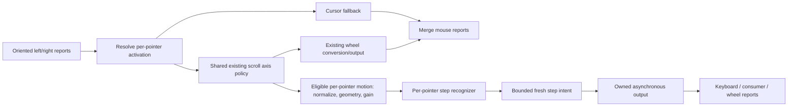
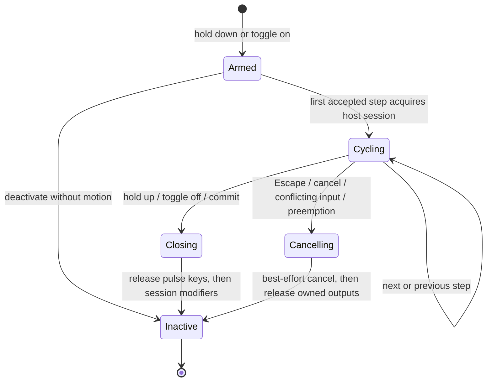

# Discrete pointing for Svalboard

Status: target architecture, 8 October 2026. An opt-in first firmware prototype
now exists; see the [implemented specification and test guide](discrete-pointing-first-pass.md)
for its scope, temporary bindings and explicit differences from this design.
Base: `svalboard/qmk` commit `9e7bc919872fb0fd4517796de47021bdbc6b3d36`.
Local branch: `design/discrete-pointing`. Nothing is intended for mainline yet.

## The proposal

Treat a pointing device as a source of motion that can temporarily operate a
**control**. A control describes what a deliberate step does. A separate
**activation** chooses which pointer operates it, and whether that choice lasts
while a key is held or until toggled off.

Examples:

- Hold **Volume / right pointer**: roll upward to increase volume, downward to
  decrease it. Release to restore the previous pointer behavior.
- Toggle **Tabs / left pointer**: each deliberate horizontal step changes a tab.
  Toggle it off to restore the previous behavior.
- Hold **Tasks / right pointer**: the first step opens and advances the task
  switcher; subsequent steps move through it. Release to accept the selection.
- Hold **Arrows** and the existing sniper key: use longer, finer movements to
  move through text or a grid. Shift can intentionally extend a selection.

All motion controls obey the existing **free scrolling / axis-lock scrolling
policy**. There is one axis-selection system, shared with ordinary scrolling;
controls must not introduce another lock, diagonal gate or breakaway setting.

The small reusable pieces are **motion normalization, step recognition,
activation ownership, and output ownership**. Volume, tabs and task switching
share the first three; task switching needs a different output lifetime.
Do not implement them as unrelated special cases, and do not turn this into a
general scripting language.

I recommend a fresh implementation in Sval. Existing BKB implementation details
are not a dependency, compatibility target or source of runtime code.

## Decisions at a glance

| Question | Proposed answer |
|---|---|
| What sets sensitivity? | Distance of normalized input per step; do not change sensor CPI on mode entry. |
| What is a step? | An intentional distance in one direction, with residual conservation and reversal qualification. |
| What about a fast roll? | Independent output-rate limiting with at most one fresh pending step per pointer; never a long backlog. |
| Does precision work? | Sniper increases motion needed per step. Boost is a per-control opt-in, initially off. |
| One mode for the whole board? | Activation and step residuals are per pointer; axis-lock state retains the existing shared scroll scope. |
| Who selects eligible axes? | The existing scroll policy, before step recognition. Free permits both axes; locked follows the existing acquisition, breakaway and timeout behavior. |
| How do keys select it? | Bindings target a pointer and a control; hold overrides toggle. |
| Can a mode hold Alt? | A cycle-session output owns Alt until commit/cancel; a mode itself does not inherently own host keys. |
| How do releases work? | Release by activation/output token, never by whatever keymap or profile is current then. |
| Are arbitrary QMK keycodes allowed? | Initially no: supported HID key chords, consumer pulses and wheel steps only. Sessions are a typed action. |
| Does the browser need to remain open? | No. Definitions and bindings live on the keyboard. |
| Is the current scroll implementation replaced? | Preserve wheel conversion and feel; extract and reuse its axis policy from the first motion spike. |
| Where does configuration live? | A capability-advertised Sval table with explicit schema and migration; Keybard edits it normally. |

## Grounding in this firmware

The most useful seam is
[`pointing_device_task_combined_user()`](../../keyboards/svalboard/keymaps/keymap_support.c).
It receives the two pointer reports before they are merged, and currently owns
sniper/boost scaling, auto-mouse detection and scroll conversion. It is not
enough to intercept the final merged mouse report: pointer identity and the
original motion have already been lost by then.

Relevant constraints from the inspected code:

1. The current sniper and boost scale objects are shared when applying them to
   both reports. A new engine needs per-pointer fractional state. Do not reuse
   those mutable objects for the new motion path.
2. Current auto-mouse detection normalizes motion to 800 CPI, but runs after
   speed scaling. Preserve this existing behavior on the untouched fallback
   path initially; make the new control path explicitly measure pre-gain input.
3. The combined hook returns early on no X/Y motion. Deferred key releases and
   session cleanup must run independently of incoming motion.
4. The board enables extended mouse reports and combined split pointing, with a
   1 ms pointing-task throttle. The Azoteq adapter samples at 10 ms. Neither is
   an appropriate clock for “one action per callback.”
5. The optical driver applies orientation before the combined hook and
   constrains sensor deltas into report fields. Normalize those oriented deltas;
   do not rotate them again. Packetization invariance starts at this input seam,
   not before any sensor/report saturation or split loss.
6. [`axis_scale.c`](../../keyboards/svalboard/axis_scale.c) illustrates residual
   preservation, but its small mutable multiplier/divisor fields are not the
   proposed numeric representation for arbitrary discrete controls.
7. [`sval_keycode_tap()`](../../modules/svalboard/core/sval.c) blocks for the
   configured delay and uses a shared synthetic key position for complex
   actions. It is not an ownership-aware asynchronous output scheduler.
8. [`action_util.c`](../../quantum/action_util.c) stores real/weak modifier
   **bitmasks**, not owner counts. Clearing one producer's bit can clear another
   producer's contribution. Basic keys and the single consumer usage have
   related collision issues.
9. The [context-layer contribution](../../modules/svalboard/core/docs/CONTEXT_LAYERS.md)
   is deliberately separate from ordinary `layer_state`. Future application
   rules must consult that contribution explicitly, not infer it from the
   union of active layer bits.

10. The existing axis lock has one shared state for combined scroll input, not
    one state per pointer. Its effective enable condition is
    `global_saved_values.axis_scroll_lock && !is_mac`. Reuse that policy and
    scope; do not silently introduce per-pointer locks or enable locking only
    for discrete controls on a host where normal scrolling bypasses it.

These are integration constraints, not requests to refactor unrelated firmware.

## The user-facing object model

### Control definition

A small numbered table of controls, with stable IDs and optional names. A
control contains:

- Output geometry: horizontal, vertical, or four-way, applied after the shared
  scroll axis policy. Geometry never overrides an axis lock.
- Up to four typed step outputs, or one bidirectional cycle-session output.
- Motion per step. Four-way controls may have different horizontal/vertical
  distances; one-dimensional controls have one distance.
- Reversal tolerance and idle reset time, with useful defaults.
- Direction inversion, independent of the existing natural-scroll preference.
- Maximum steps per second and a bounded pending-step lifetime.
- Modifier policy: inherit relevant physical modifiers, or require a clean
  chord context. No silent suppression of the user's held keys.
- Whether sniper and boost affect the control. Sniper on, boost off by default.

An initial advertised capacity of 16 controls is ample for experimentation.
This is a sizing proposal, not a hard-coded protocol limit. A profile name is
metadata, not an instruction to firmware. “Volume” is a vertical pair of
consumer usages, not a new firmware `VOLUME_MODE` enum.

### Activation binding

A second small table binds a control to **left** or **right** pointer. The
keymap contains `Point hold(binding)` or `Point toggle(binding)`. These are
symbolic names here; allocate actual QMK codes only after checking all existing
Sval/custom ranges.

Why a binding table? It avoids multiplying the keycode namespace by every
control × pointer × activation style. It also lets Keybard present a concise
tile such as “Hold Volume · Right” while preserving a stable reference in files.

Initially, hold activators must originate from physical key events with a
stable press/release identity. Do not pretend the shared synthetic position
used by arbitrary tap dances/macros provides independent hold ownership.
Generated activators need an explicit source-token API in a later extension.
The picker must indicate this restriction wherever it would otherwise offer
the activators as a combo, macro or tap-dance output.

Do not support an implicit “whichever pointer moves next” target. An explicit
side is predictable. “Both pointers” can be added as a binding that acquires
two independent runtimes, but is not needed for the first version; an exclusive
task session needs a deliberate multi-pointer policy before that option ships.

### Runtime is not configuration

No persistent writes on mode entry, motion, toggling, precision presses or
release. Persistent settings describe the controls and bindings. Runtime owns:

- Physical activation tokens and press order.
- The current toggle for each pointer.
- Effective control, activation generation and resolved immutable definition.
- Per-pointer step residuals and reversal state. Axis selection belongs to the
  shared scroll policy, not these runtimes.
- Pending step intent, limiter timestamps and in-flight output ownership.
- A separate, at-most-one exclusive host session.

Reboot clears all transient state and returns to the existing pointer defaults.
Do not resume a task switcher or latched motion control after reboot.

## Motion pipeline



The policy receives both axes from every participating scroll/control pointer
before output geometry discards an axis. Ordinary cursor-only motion does not
participate. Preserve source identity through policy evaluation so admitted
motion goes to that pointer's chosen output. Evaluate the policy once per
shared scroll interval, not separately for each output consumer. The diagram
shows ownership, not permission to reorder legacy arithmetic: preserve the
existing scroll conversion, policy-input units and batching during extraction.
Step residuals stay per pointer; the axis-policy state keeps its existing
combined scope.

Motion that a discrete control consumes must not leak into cursor X/Y. For the
first version, a one-dimensional control consumes both X/Y axes; the unused
axis does not accidentally move the cursor. Axis mixing can be added later as
an explicit feature, not an undocumented side effect.

Nonexclusive controls preserve mouse-button behavior. Native H/V reports
remain on the existing wheel path unless a future input binding explicitly
selects them. The initial control input is X/Y motion, not every conceivable
pointer gesture. Exclusive task-session behavior is more restrictive below.

### Normalize before sensitivity

Use a board-independent reference distance: counts at 800 CPI.

```text
normalized_delta = oriented_sensor_delta × 800 / effective_sensor_cpi
control_delta    = admitted_normalized_delta × control_gain × temporary_precision_gain
```

Only policy-admitted motion reaches `control_delta`. The policy uses the
existing scroll-intent scale and timing, independently of a control's step
distance, rate cap or gain. Existing scroll scaling keeps its current effect
on policy input; control-specific gain applies downstream. Characterize that
boundary before moving any arithmetic.

For optical trackballs this means changing pointer DPI need not change volume
or task-selection distance. Pointer DPI remains a sensor setting; controls do
not change it when activated.

Use signed 64-bit intermediates and Q16.16 normalized distances, with a retained
division remainder for each axis. Signed division must truncate toward zero.
Keep runtime residuals bounded and validate nonzero denominators and threshold
ranges. A negative extreme must be widened before negation. Do not discard
sub-unit motion once per report: that makes sensitivity depend on polling rate.

The current driver getter caches requested CPI. Before claiming physical
distance consistency, verify the effective hardware value after quantization
or clamping. For TrackPoint and sensors whose CPI setting is not a calibrated
linear distance, advertise a logical-motion gain instead. Do not divide by a
fictional CPI or display unearned millimeter precision.

Keybard should say **Motion per step**, with a live calibration gesture and an
advanced numeric reference-distance value. Approximate millimeters can be
shown only for a calibrated optical path, clearly labeled as sensor travel,
not distance of the finger across the ball.

Changing CPI, orientation, gain or step distance resets that pointer's partial
motion and pending intent without generating a step. Live definition edits
are rejected while the definition is active; an explicit deactivation is
required first. This prevents reinterpreting a half-finished gesture.

### Keep three different ideas separate

| Control | Meaning | Why it is separate |
|---|---|---|
| Motion per step, `D` | Travel required for an action | Controls spatial effort. |
| Reversal tolerance, `R` | Opposite travel needed to recognize a changed intention | Stops small backwards tremors from resetting progress. |
| Maximum output rate | Minimum time between emitted actions | Limits large jumps without pretending motion was smaller. |

An experimental starting point is `D = 64` reference counts, `R = 8`, and an
idle reset of 250 ms. These are simulation parameters, not ergonomic defaults
established by testing. Task switching will likely want more travel and a
lower rate than ordinary scrolling. Do not expose every parameter on the
first screen; keep two primary controls, Motion per step and Maximum rate,
with advanced tuning available.

### Proposed step recognizer: distance from an intentional turn

Use one dimensional recognizers for the supported axes. Each has:

```text
direction       -1, 0, +1
progress        unspent distance in direction, 0 <= progress < D
reverse_travel  distance back from the most recent forward extreme
```

1. The first movement establishes direction. A full `D` is needed for the
   first output. Holding/toggling a control produces no output by itself.
2. Motion continuing in that direction advances `progress`. Every full `D`
   produces one step; retain the remainder. A large packet can recognize
   multiple steps arithmetically without a per-count loop.
3. Small opposite motion accumulates in `reverse_travel`. If movement resumes
   forward before `R`, it first repays that reverse excursion. Only travel
   beyond the old extreme adds progress. Thus `-1, +1` noise cannot manufacture
   forward distance.
4. Once opposite motion reaches `R`, accept the new direction. Discard the old
   partial forward progress; start new progress with **all** the reverse
   distance from the turning point, including the portion that established
   intent. Recognize reverse steps at `D`, not at `D + R`.
5. Idle longer than the configured reset clears partial step progress and
   reversal state. It does not reset the shared scroll axis lock, disable a
   toggle or commit an active task session. Do not let tiny movements several seconds apart complete a stale
   partial action.

Require `0 < R <= D`. Preserve exact-threshold behavior: `D` produces a step;
it does not require an extra count. Specify reset-at-timeout using `>=`, and
use wrap-safe elapsed times in firmware.

This is a relative gesture rule, not a reversible position quantizer. If a
user moves most of a step right, deliberately turns left, then deliberately
turns right again, unfinished travel from the earlier gesture is discarded.
That is intentional. Below rate saturation, segmentation into smaller reports
does not change results for the same observed path and timestamps.

### Why not the two obvious alternatives?

- **One signed accumulator:** simple and good for continuous wheel motion, but
  a nearly complete positive remainder makes the first negative action require
  almost twice the normal travel. That feels like resistance on reversal.
- **Reset remainder whenever sign changes:** removes that resistance, but tiny
  tracking noise destroys real progress, and naive absolute-distance counting
  can turn oscillation into actions.
- **Position cells with a Schmitt boundary:** excellent for an absolute dial
  with a meaningful selected position, but the first step, return crossing and
  resting phase behave differently from a relative roll gesture. Keep it as
  an alternative to compare experimentally, not another user-facing mode yet.

The [reference model](../../experiments/discrete_pointing/model.py) makes the
proposed rule concrete; its tests probe reversal debt, oscillation and report
partitioning. It does not establish which feel people prefer.

### One axis policy for scrolling and discrete controls

The existing free/axis-lock preference and its existing key binding govern
**all** these controls. There is no per-control lock flag, dominance ratio,
axis-acquisition distance, axis timeout or breakaway threshold. Four-way
controls use this same policy without an additional direction-intent gate.

| Effective existing scroll policy | Discrete-control behavior |
|---|---|
| Free scrolling | Both axes are eligible. Four-way controls may recognize both horizontal and vertical steps on a diagonal. A one-axis control uses only its configured axis. |
| Axis locking active | Only motion admitted by the existing scroll lock reaches step recognition. Acquisition, orthogonal breakaway and lock release follow that same policy. |
| Existing host-specific bypass | Use the same effective free behavior as ordinary scrolling; do not consult only the saved lock checkbox. |

For example, with a vertical lock active, horizontal Tabs does not bypass it.
Both raw axes still feed the shared policy so horizontal motion can reach the
existing breakaway threshold. Only then can admitted horizontal travel earn a
tab step. Volume likewise cannot invent a vertical override to a horizontal
lock. Hold and toggle keys choose outputs; they do not change axis policy.

The current implementation combines both scrolling pointers into one lock
domain. Preserve this scope in the first implementation, including when one
pointer scrolls and the other operates a control. Their motions can affect the
same lock, as they can today. Separate step accumulators do not imply separate
locks. Changing to per-pointer lock domains would be a separate scroll-design
change applying consistently to ordinary scrolling and controls.

The shared policy adapter should expose an allowed-axis mask plus transition
information and retain per-source admitted deltas. It must preserve existing
acquisition/breakaway handling, including motion discarded at a transition;
a mask alone must not accidentally credit movement the old path discarded.
Do not replace the existing asymmetric acquisition rules with a generic 3:2
winner selection or add an ambiguous-diagonal dead zone.

Lifecycle rules:

- Switching between scroll and a control, or between controls, clears that
  pointer's step progress and pending actions. It does not gratuitously reset
  or reacquire the shared lock. Existing scroll-policy lifecycle owns it.
  Tag buffered per-source motion with its activation generation so a scroll
  interval cannot deliver old motion to a newly selected output.
- Suppressed motion earns no step progress and cannot queue a later action.
  On an eligibility change, clear affected step residuals and pending intents
  before accepting new admitted motion. Do not replay old orthogonal travel.
- Changes to the global policy invalidate affected discrete progress/pending
  work before further recognition. A mode exit still finishes releases for
  outputs already started; it does not reset another pointer's lock.
- Step idle and qualified sign reversal affect only distance recognition.
  Left/right reversal on an admitted horizontal axis is not axis switching.
  Its tolerance must never become a second X/Y breakaway threshold.
- Free-mode diagonals can produce two candidates. Serialize simultaneous ties
  in a documented stable order with fair arbitration under the bounded rate
  cap; do not disguise output contention as another direction gate. The
  one-dimensional model does not yet implement this multi-axis arbitration.

Natural-scroll direction remains applied once in the wheel output adapter.
Semantic controls retain explicit up/down or left/right mappings and optional
inversion; neither changes which axes are admitted. Inverting a volume mapping
must not invert the lock's input or double-invert normal scrolling.

The first firmware spike must extract this policy with trace-equivalence tests
against the existing scroll path. Include the actual no-motion call schedule:
the current hook's early return matters to timeout delivery. Do not silently
repair timeout behavior during extraction, or claim that a nominal timeout
constant proves the effective release behavior. Any shared-policy correction
needs its own regression review across wheel and control outputs.

### Rate limiting is a declared loss policy

Recognized spatial steps and emitted host actions are separate counts.
Unlimited replay after a fast roll is unacceptable for volume, undo and tasks.
Conversely, a rate cap cannot preserve every spatial step without delaying
some. Make that tradeoff explicit rather than hiding it in sensitivity math.

For key/consumer controls:

- A per-pointer limiter controls start-to-start spacing of output pulses.
- There is at most **one pending step** per pointer, carrying direction,
  timestamp and activation generation. Coalesce excess candidates and count
  them in diagnostics; do not build a FIFO of every detent.
- Pending intent expires after a short advertised age, provisionally 80 ms.
  A new same-direction step may refresh it. Never refresh it from no motion.
- An accepted reversal clears pending intent in the old direction immediately,
  even if the reverse gesture has not yet traveled far enough for a new step.
- Effective-control changes, commit and cancel discard pending intent. Finish
  releasing any already-started output; do not “catch up” before exit.
- The scheduler can complete a single fresh trailing step after motion stops,
  within that bounded age. It cannot promise literally zero trailing output.
- Two pointers share the actual output resource through fair arbitration. Do
  not let one permanently busy pointer starve the other. Cleanup has priority
  over new actions.

The limiter supplies intent to the broker, not HID events. Its start timestamp
advances only when the broker accepts the pulse, not when a sensor requests it.
The model's `take()` stands in for this acceptance; production code needs a
single atomic admission operation so a failed enqueue cannot consume a step
or falsely mark a pulse started.

Above the rate cap, packet timing can change how many requests are coalesced;
we explicitly do **not** claim distance-to-output invariance there. Keybard's
tuning readout should distinguish recognized, emitted and coalesced steps.

Do not add acceleration curves initially. First learn whether distance,
reversal and a rate cap feel right. Velocity acceleration would otherwise mask
flaws in all three.

### Wheel output is a sibling, not a key pulse

An experimental discrete-wheel control can share the distance recognizer and
emit signed H/V increments. A mouse wheel report encodes a delta and needs no
key-up phase. Accumulate/coalesce bounded deltas appropriate to wheel output;
do not rate-limit it as if it were Alt+Tab.

Preserve today's wheel conversion and feel. Host scroll units vary, and this
firmware already has a macOS divisor. A wheel detent is not a pixel, line, or
guaranteed OS scroll distance. Sharing the existing axis policy is mandatory
from the first spike; replacing the legacy wheel accumulator with the new step
recognizer is a separate, later migration after side-by-side feel tests.

The reviewed board also enables high-resolution scroll with a configured
multiplier of 120 and extended wheel reports. A profile's logical wheel step
must go through a host-resolution-aware adapter; writing raw `v = 1` is not
necessarily one conventional notch. Verify feature-report negotiation and the
non-high-resolution fallback independently of spatial recognition.

## Activation and restoration

Per pointer, resolve:

```text
newest valid held binding
    else current toggled binding
    else optional future layer rule
    else existing pointer/scroll behavior
```

There is one toggled binding per pointer. Toggling another binding replaces it;
toggling the same binding clears it. Hold activations form an ordered set, not
one global `held` Boolean. Multiple physical keys can refer to the same control.
Releasing an older one must not release a newer one.

Tokens are keyed by physical press identity, with the resolved binding frozen
on press. Key release removes that token even if a layer, layout or label has
changed. Token capacity is bounded and advertised; overflow rejects only the
new activation and leaves existing state intact. No memory allocation per key.

Example: toggle Volume; hold Tabs; hold Arrows; release Tabs. Arrows stays
active. Release Arrows and Volume returns. It starts with fresh motion state,
not the partial step it had before being covered.

Any change in the winning activation is a generation boundary, even when two
bindings reference the same definition. Close the old control's output,
invalidate queued work and reset spatial state before opening the new one.
This slightly conservative rule is more predictable than trying to preserve
invisible momentum across changes in ownership.

An exclusive session is the exception to automatic restoration: when it is
preempted or explicitly completed, invalidate its activation until that hold
key is released; remove its toggle if it was toggled. Never silently resurrect
a half-finished task switcher under a released temporary mode.

### Relationship with auto mouse and layers

Use an activation-owned mouse-layer lease while a physical mode-hold key is
down. Do not fake extra mouse button presses or mutate the current generic
mouse-key counter. Releasing that lease cannot release a layer still owned by
another mouse key or ordinary movement.

A toggled nonexclusive control does not pin the mouse layer forever. Its
eligible raw motion may activate/refresh the layer according to existing
per-pointer settings; its generated volume/tab keys are not fresh physical
activity. Capture the activation before auto-mouse layer changes can affect
resolution and protect the eventual key-up.

Layer-to-control rules are deferred until direct hold/toggle use is sound.
When added, they are a lower-priority source contribution, not imperative
“enter mode / exit mode” side effects in each layer callback. The auto-mouse
layer cannot recursively change the rule that created it without a specified
fixed precedence. Explicit holds/toggles always win. App-context rules must
use the independent context-layer API and expire without clearing manual state.

## Output ownership: the difficult integration seam

### Typed outputs, intentionally finite

| Output | Payload | Lifetime |
|---|---|---|
| Key pulse | Basic non-modifier keyboard usage + modifier mask | Down, then up through scheduler |
| Consumer pulse | One supported consumer usage | Usage, then neutral through scheduler |
| Wheel step | Signed H/V increment | One relative mouse report contribution |
| Cycle session | Session modifiers, forward/reverse pulses, cancel action | Owns session state until exit |

QMK layer keys, mode activators, boot/reset keys, tap dances and arbitrary
macros are not accepted as step outputs in version one. The format can be
extended with new typed actions later. This restriction is important to the
design: a control engine cannot guarantee cleanup for arbitrary user code that
sets global state, blocks, or recursively invokes another control.

For normal editing navigation, an explicit **inherit** modifier policy permits
Shift+Arrows and Ctrl+Arrows. A **clean chord** policy rejects/defer-expires a
pulse if foreign modifiers would change its meaning. Never clear real or weak
modifiers to force a shortcut, and never save/restore a stale snapshot afterward.

### A small report-contribution broker

Do not implement ownership by `register_code16()` plus a delayed
`unregister_code16()`. Do not assume a new weak-modifier bit is owned exclusively
by this engine. Instead keep engine-owned contributions outside QMK's existing
mutable key/modifier stores, and compose them into a copy of the outgoing
keyboard report in both 6KRO and NKRO paths.

Conceptually:

```text
base report       = QMK's current report, including its normal transformations
point contribution = union of currently owned point-action keys/modifiers
outgoing report   = base report plus validated point contribution
```

The base report remains intact. Releasing an owner removes only its
contribution. A held physical modifier is still held when the point action
finishes. Point action chords are explicit HID output, not inputs fed back
through combos, tap dance, key overrides, alternate repeat or one-shot state.
Document that distinction in the action picker. They do not consume a
one-shot modifier by pretending to be a physical key.

This requires narrow, reviewed hooks in the QMK report layer. Put them behind
the Sval pointing capability and a no-op/default-disabled path. Do not fork
the whole action engine. Hooks must address these real resource constraints:

- If the base already holds the same non-modifier key, a second independent
  “tap” cannot be represented in HID without releasing that key. Reject or
  expire the generated pulse; never release the physical key to make room.
- A pulse that adds modifiers also requires that no unrelated base
  non-modifier key is held. Otherwise existing key repeat could inherit the
  new modifiers even without a new physical press. Suppress the pulse, not
  the physical hold. Unmodified inherited arrow output can use a less
  restrictive policy, but that policy is explicit and tested.
- In 6KRO, if the report has no free slot, reject/expire the pulse. Never evict
  a physical key. NKRO has different capacity but still needs ownership.
- The consumer endpoint is effectively one usage. A generated pulse must not
  clear a physical media-key hold, nor restore a stale consumer usage. The
  consumer-send path needs an equivalent producer boundary/arbiter; checking
  only `host_last_consumer_usage()` at the start is insufficient.
- Key modifiers are report-wide, not attached to individual usages. If a
  physical character arrives while a synthetic chord is down, it could inherit
  those modifiers. Physical action dispatch must first terminate conflicting
  synthetic chords in report order; this is a required integration seam, not
  something owner bitmasks alone solve.
- QMK-originated synthetic output (existing macros, tap dance and so on) can
  race too. They require a producer boundary at report mutation/output, not
  just a physical-matrix hook. Give ordinary QMK output priority and cancel
  conflicting point output without replaying it later.
- The broker must preserve independent unchanged raw mouse-button state. It
  must not reset the entire keyboard as routine cleanup.

A per-action contribution token plus a bounded in-flight pulse is enough. Do
not expose a general resource manager to the user. There may be several
activation owners, but keyboard pulses can serialize through a single writer
and consumer pulses through their own single-usage resource.

### Nonblocking pulse execution

Each pulse runs as explicit phases, for example:

```text
READY -> KEY_DOWN_ACCEPTED -> KEY_UP_ACCEPTED -> QUIET_GAP -> READY
```

For a modified chord, establish modifiers before its down edge and release
only the action-owned modifiers after its up edge. A session may keep its own
modifiers between pulses. Use elapsed monotonic time, not scan counts or
`wait_ms()`. Pulse width and neutral gap are transport parameters, separate
from motion distance and output-rate limits.

“Accepted” must mean the report was successfully queued/accepted by the local
transport, not just that a void send helper was called. It does not mean the
OS has handled the shortcut. The current host abstraction does not provide
that complete contract. In the inspected ChibiOS path,
[`send_report()`](../../tmk_core/protocol/chibios/usb_main.c) does return queue
success, but the keyboard/extra report wrappers discard it and use a timeout
of up to 100 ms. The report-deduplication caches also update before transport
success is established. A failed send must not poison a last-sent cache and
silence the retry of a release. Audit these boundaries and implement the
smallest necessary readiness/ordering hook before claiming reliable rapid pulses.
Do not advertise an arbitrary 1 ms or 10 ms delay as a universal guarantee.

Release-only work continues when the pointer is stationary, the device is
lifted, or the next sensor poll is throttled. Give cleanup priority and reserve
transport capacity for releases. If cleanup cannot proceed, stop admitting new
actions. Physical input ordering under endpoint backpressure is a prototype
gate: solve it at the dispatch/transport boundary rather than adding an
unbounded queue of physical keys.

Do not bypass QMK's caches by privately writing the USB endpoint from the mode
engine. There must be one coherent composed-report writer. Its transaction
contract is: either accept the down edge with a guaranteed cleanup path, or
admit nothing. Once accepted, cleanup is obligatory even if the activation is
gone. Host disconnect can break delivery, but must still clear local ownership.

## Task switching as a cycle session

A task switcher cannot be represented faithfully by a series of independent
Alt+Tab macros. Its output has an **open lifetime**. Model a bidirectional cycle
session with a modifier mask, forward/reverse pulses, and optional cancel
sequence. Platform presets are data. Their actual OS/application behavior
still needs verification on each supported target.



### Concrete semantics

- Arming emits nothing. The first admitted step acquires the exclusive session,
  presses the session modifier and sends the appropriate first cycle pulse.
  Reject acquisition if a foreign modifier/nonmodifier/consumer hold makes a
  clean session impossible. Do not suppress the user's held inputs.
- Left/backward uses the configured reverse chord; temporary Shift belongs to
  that pulse and is gone before the next forward pulse. Session Alt/GUI remains.
- On hold release or toggle-off, discard unstarted steps, release any in-flight
  Tab/Shift, then release the session modifier. Do not flush accumulated steps
  just before accepting a selection.
- An explicit Commit action closes and disarms; an explicit Cancel closes and
  disarms. If the original hold key remains down, its token stays inhibited
  until physical release. A completed session does not reopen on the next roll.
- Enter commits and Escape cancels while cycling; consume their matched
  press/release pairs. A key already down before acquisition prevents starting
  the clean session, so it cannot become an ambiguous new commit key.
- Primary mouse click commits; secondary click cancels. Other buttons cancel.
  Consume those button transitions through their releases, rather than leaking
  a click into the newly selected application. This requires handling both
  mouse-key events and pointer-report button edges; ordinary controls still
  preserve buttons.
- Other new physical typing ends the session before that event is processed.
  Prefer a verified cancel sequence, then forward the event after cleanup.
  If the OS cannot cancel the switcher as expected, the input may reach the
  currently selected app. Firmware cannot guarantee or restore application
  focus, and the UI must not suggest otherwise.
- While cycling, suppress unrelated pointer X/Y/H/V input on the other side.
  Do not let a second pointer casually scroll a background application while
  Alt/GUI is held. It becomes usable again after the session closes.
- Only one exclusive cycle session can own the host at once. Another explicit
  activation first cancels the old session, invalidates its activation, and
  may arm a new one after cleanup. Never combine session modifiers from two
  independently owned task switchers.

### Inactivity and lost releases

A physical hold commits on release; a toggle can be exited by the same toggle
key, Commit or Cancel. Motion idle only resets spatial state. It must not be
confused with losing an activation.

Nevertheless, use a bounded **session watchdog** for lost events. An initial
10-second inactivity timeout is a tunable experimental value. Only selected
pointer motion or session-control input refreshes it; scan loops do not.
Timeout cancels/disarms and releases owned state. The timeout is not a general
modifier timeout and must not touch the user's physical holds.

On suspend, disconnect, split failure or shutdown, invalidate activations and
all pending work. Release owned contributions while transport permits; if it
does not, clear local state and send a neutral supplemental state on reconnect.
A powered-off keyboard cannot promise that a previous host observed a final
release or restored focus. Never resume an old session after reconnect.

Escape is not universally a safe cancellation shortcut for every OS switcher.
Do not send it from the Armed state, where no switcher has been opened. Treat
platform cancellation as verified preset behavior with a best-effort fallback
of releasing owned state, not as a guaranteed transaction rollback.

## Firmware boundaries and integration sequence

Suggested new implementation files, not created as production code in this draft:

| Component | Responsibility | Deliberately does not own |
|---|---|---|
| Shared scroll-policy adapter | Existing free/lock behavior, combined lock state, admitted axes and transitions | Control step distances, rate caps, host key actions |
| `sval_point_motion.c` | Fixed-point normalization and per-axis distance/reversal recognition on admitted motion | Axis locking, QMK key events, storage, host state |
| `sval_point_control.c` | Per-pointer activation resolution, generation changes and limiter | USB packet transport |
| `sval_point_output.c` | Pulse/session lifetimes and contribution tokens | Sensor CPI or axis thresholds |
| `sval_point_config.c` | Validation, table serialization and transactions | Runtime pointer/host state |
| Board adapter near `keymap_support.c` | Feed reports; keep legacy fallback; reconcile auto mouse | Mode-specific volume/tab behavior |
| Narrow QMK report/dispatch hooks | Compose owned output; order releases and competing producers | User profile logic |

All behavior executes on the USB primary side, after the split reports acquire
stable left/right identity. Do not let both halves generate keyboard actions.
Switching which half has USB requires the same configuration and binding tables
to be available there. Existing split motion forwarding alone does not promise
that configuration persistence is mirrored. Verify storage synchronization;
if it is absent, add an acknowledged table-generation transfer rather than
claiming either-side equivalence. Do not stream every step over the split link.

Start with direct hold/toggle and one-dimensional controls. Automatic rules,
four-way arbitration, compound gestures and custom macros should not obscure
whether the essential motion and release contracts are sound.

## Storage and protocol, without a premature wire ABI

Use the existing wrapped Sval protocol. Add a capability bit and descriptor
that reports schema version, control/binding capacity, supported action kinds,
sensor normalization capabilities, numeric bounds and runtime diagnostics.
Allocate actual command numbers when integration begins, not in a speculative
document while other feature branches are active.

The conceptual operations are:

```text
GET_CAPABILITIES
READ_CONTROL / READ_BINDING
BEGIN_EDIT(expected_generation)
WRITE_CHUNK(transaction, bounded_index, offset, bytes)
VALIDATE_AND_COMMIT(transaction)
ABORT_EDIT(transaction)
GET_RUNTIME_STATUS
```

Bind edit transactions to the existing client identity. Validate the complete
candidate table and all binding references before making it visible. Use an
expected generation to reject stale concurrent edits. The wrapper consumes
six bytes of a 32-byte HID report; table records need explicit chunk framing,
bounds and transaction expiry. Never memcpy packed compiler structs directly
into the wire representation.

Reject commits that change an active definition/binding with `BUSY_ACTIVE`.
Keybard can offer to deactivate first. Disconnect/expiry discards uncommitted
RAM changes. Apply live updates as small transactions and manual updates as a
batch. No partial table should become a runnable control after a failed write.

The current fixed EEPROM layout and validity stamp make adding a table a real
migration task. Select and document a region without shifting old addresses
silently or colliding with macro capacity. Proposed durable representation:
versioned section with length, generation and CRC, published via a commit
marker/dual-bank mechanism supported by the settings backend. Budget both
banks before choosing capacities. A runtime table swap alone is not a durable
transaction; power-cut testing must establish old-or-new recovery.

Unknown/newer section versions disable these controls while preserving
unrelated settings. Corruption restores only this section's defaults where
the storage architecture permits it; do not reset all keymaps to repair one
bad pointing profile. Whether the existing backend can meet these guarantees
without a larger storage migration is an explicit early investigation.

Provisional budget: 16 controls at roughly 96–160 serialized bytes each,
16 bindings, small label storage and two runtime contexts. Expect a few KiB
of persistent data, doubled if dual-bank commits are needed, plus bounded
runtime/transaction RAM. These are planning ranges, not measured layouts;
do not freeze record sizes or reduce existing macro capacity before measuring.

Layout files use stable symbolic action/key names and control IDs, with a
schema version. UI list order must not redefine IDs. Import preview reports
unsupported types, remapped IDs, missing references and capacity overflow.
Old firmware cannot silently apply half a pointing profile. Extend backups,
diffs, restore and export together with the editor.

## Keybard interaction design

Inside Pointing Devices, retain today's left/right DPI, scrolling and auto-mouse
settings. Their free/axis-lock selection also governs Controls; show its
effective state and any host bypass without adding a second selector. Add
**Controls** with a small list of named definitions. Do not start with a dense
matrix of every parameter.

The initial flow:

1. Choose Volume, Tabs, Arrows, Tasks or Custom from a preset picker.
2. Choose Left or Right pointer.
3. Choose Hold or Toggle and assign the resulting key tile.
4. Adjust Motion per step and Maximum rate.
5. Optionally open Advanced for inversion, reversal/idle behavior and modifier
   policy. Edit the outputs using a capability-filtered action picker.

Presets are editable data, not firmware magic. Platform selection belongs to
the control's actual chord definitions; do not rely exclusively on USB-based
OS detection, which does not identify application shortcuts or Linux desktop
policies. The labels must show what keys will actually be sent.

Provide an explicit **calibration mode** that reports normalized motion and
recognized steps without emitting host actions. It must be device-side, entered
only by a deliberate user action, and have a short renewable lease. Closing
the browser or losing the lease restores prior normal pointer behavior; it
does not leave the pointer trapped in a dead test mode. Never activate live
volume/undo/task output merely because an editor row is selected.

Useful readouts are recognized steps, emitted steps, coalesced/expired steps,
active side and blocked-output reason. A modest polled snapshot suffices;
do not make the GUI consume or depend on a per-motion event stream. An optional
overlay can show an active toggle or task session. Lack of an overlay must not
affect mode cleanup or normal use.

## What to prove before shipping anything

### Pure motion properties

- Equal normalized paths yield equal recognized steps at different CPI values
  and report subdivisions, away from explicit timing reset boundaries.
- Very slow sub-count movement eventually produces a step.
- `D` is enough for first and steady-state steps; excess distance is retained.
- Qualified reversal discards previous-direction debt; small oscillation does
  not manufacture distance or erase progress.
- Idle expiry, activation changes, CPI changes and gain changes clear partial
  state without generating a step.
- Two pointers cannot donate residuals to each other.
- Ordinary-scroll traces remain equivalent before/after shared-policy extraction:
  free motion, diagonals, acquisition, breakaway, timeout and host bypass.
- Identical policy input yields identical eligible axes whether the output is
  wheel, volume, tabs or arrows. Step distance/gain/rate cannot change the lock.
- Locked-out axes cannot accumulate steps or emit stale actions after unlock;
  free-mode four-way diagonals can recognize both axes.
- Mixed wheel/control use preserves the existing combined lock scope. Hold,
  toggle and nested restoration do not create or reset independent locks.
- Policy changes invalidate affected pending work; stopped-motion traces check
  actual timeout delivery, not just the policy function in isolation.
- Extreme signed reports and gains do not overflow arithmetic.

### Activation and temporal properties

- Nested holds restore the correct previous control; out-of-order release is
  harmless. The same binding held on two keys has two owners.
- Toggled state is replaced/cleared according to the stated rules, and never
  restored after a completed exclusive session.
- A pending step expires, is canceled by accepted reversal, and cannot cross
  an activation generation or replay after release.
- Output-rate caps hold under bursts without accumulating a long tail.
- Release tasks run while all sensors are motionless and while sensor polling
  is throttled.

### Report and device integration properties

- Preserve physical modifiers and keys on every successful, rejected, canceled
  and interrupted action. Include same-key collisions and 6KRO saturation.
- Exercise one-shot/weak modifiers, overrides, tap dances, macros and consumer
  holds as competing producers. No synthetic chord modifies unrelated typing.
- Verify down/up ordering and neutral gaps with a fake transport that can be
  busy, then capture actual HID on a test board. A host model is insufficient.
- Task switching supports forward/backward, hold release, toggle-off, Enter,
  Escape, buttons, typing interruption, watchdog and disconnect without owned
  keys remaining logically down.
- Repeat with either half as primary; simulate split loss and restoration.
- Power-cut durable table edits and prove recovery, old-firmware rejection,
  round-trip files and preservation of unrelated settings.

### Feel study, after correctness

Compare three gesture policies using identical recorded motion traces and
then real use: signed residual, the proposed qualified-turn recognizer, and
a hysteretic position-cell alternative. Test deliberate reversals, slow fine
motion, tremor, fast rolls and two-pointer use. Log normalized traces and
counts with user-controlled capture. Choose defaults from those observations;
unit tests cannot choose ergonomics.

## Staging and rough scope

| Stage | Exit condition | Indicative engineering effort |
|---|---|---|
| Architecture/model, this draft | Explicit contracts and reproducible motion/lifecycle examples | Completed locally; no device proof |
| Motion-only firmware spike | Shared scroll-policy extraction with trace equivalence, per-side admitted motion and step recognition; no host key injection | 3–6 days |
| Owned output and transport spike | No collisions/stuck output under fake transport and test-board captures | 5–10 days; largest uncertainty |
| Volume/tabs hold-toggle slice | Correct motion and restore semantics using fixed in-memory profiles | 3–5 days after the two spikes |
| Typed cycle session | OS-tested commit/cancel, interruption and watchdog | 3–6 days after owned output |
| Configurable release | Table migration, protocol, Keybard editor, files, regression/feel work | 8–15 days after primitives |

This is roughly 22–42 person-days after the design/model stage, with shared work
between stages. It is a more conservative scope than “wire a few shortcuts to
the ball,” because input ownership and reliable transport are now explicit.
Automatic layer rules, arbitrary macros, replacing legacy wheel quantization
and adding new sensor types are outside that estimate. Shared axis-policy
integration is included and is a prerequisite, not deferred work.

The highest-leverage first implementation is a **motion-only spike plus an
owned-output spike**, not a complete settings panel. If either seam is awkward,
learn that before choosing a permanent schema. Keep the default build unchanged
and opt into the experiment only in dedicated keymaps.

## This worktree's deliverables and limits

- This architecture document, with choices, tradeoffs and unresolved gates.
- A small executable reference model and behavioral tests under
  [`experiments/discrete_pointing/`](../../experiments/discrete_pointing/README.md).
- Generated trace examples contrasting ordinary signed accumulation with the
  proposed reversal semantics.

The model is specification support, not embedded code. It uses Python exact
fractions where firmware will need bounded fixed-point arithmetic. It does not
simulate USB acceptance, QMK modifier composition, shared scroll-policy
integration, multi-axis arbitration, persistent transactions or operating-system
focus. Passing it is not proof of
firmware correctness. The first prototype changes firmware only on this local branch behind an opt-in
build flag (plus a behavior-preserving shared-policy extraction). It allocates
temporary keycodes, not the proposed configuration-table protocol or storage
layout. Mainline remains unchanged.

Validation on this draft: 30 reference-model tests pass, including deterministic
randomized report partitioning, high-CPI fractional movement, idle boundaries,
qualified reversal, pending-intent expiry and nested activation ownership.
