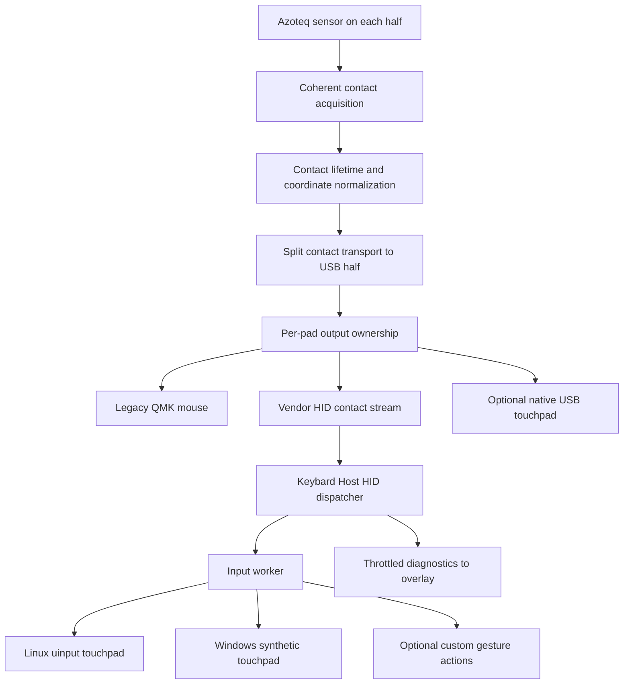

# Azoteq multitouch and Keybard Host

Research and proposed architecture, 2026-10-12. Inspected firmware commit
`c4226bb74f` and Keybard commit `28401de`. The full architecture remains a design.
An opt-in Windows/local-pad prototype now exists; its implementation and measured
validation are documented in [the prototype README](../tools/multitouch/README.md).
Windows synthetic touchpad scroll and pointer delivery, hardware idle streaming,
and concurrent Keybard profile reads have passed on Windows build 26200.

## Decision

Build one lossless contact pipeline with interchangeable output backends. Start
with a contact-stream prototype in the **existing Keybard Host**, then test Linux
uinput and the newly documented Windows synthetic-touchpad API. Keep native USB
Precision Touchpad output as a first-class alternative, particularly if Windows
runtime support is inadequate. Do not start a separate daemon or write a Windows
kernel driver before those experiments.

USB HID is capable of multitouch, including alongside a keyboard. The limitation
here is the current QMK mouse/digitizer implementation. Microsoft explicitly
supports Precision Touchpads over USB using its inbox drivers. This is firmware
work, not a fundamental USB class restriction.
[Microsoft protocol implementation](https://learn.microsoft.com/en-us/windows-hardware/design/component-guidelines/touchpad-protocol-implementation).

The existing daemon changes the economics: packaging, a resident process, HID
discovery, reconnects, device selection, and settings/UI already exist. It does
not eliminate the need for a correct OS input backend or stream scheduling.

## What the current code loses

| Location | Observed behavior | Required change |
| --- | --- | --- |
| `keyboards/svalboard/azoteq/config.h` | TPS43 selected; RDY/motion pin commented out; combined split pointing enabled | Identify actual sensor firmware and wiring; add contact acquisition configuration |
| `drivers/sensors/azoteq_iqs5xx.c` | Reads only 10 bytes starting at `0x000C`; converts gestures and relative movement into `report_mouse_t` | Read contact data before mouse conversion |
| `keyboards/svalboard/azoteq/azoteq.c` | Polling wrapper targets 10 ms and retains mouse button state | Make acquisition single-owner; derive fallback mouse from that same sample |
| `quantum/split_common/transactions.c` | Split pointing transports mouse reports | Introduce a separate contact transaction |
| `keyboards/svalboard/keymaps/keymap_support.c` | Combines mouse streams and applies DPI/scroll/auto-mouse behavior | Make those policies aware of touchpad ownership |
| `tmk_core/protocol/usb_descriptor.c` | Existing digitizer is a single stylus; Raw HID reports are 32 bytes at 1 ms | New reports required for native touchpad; framing required for existing Raw HID |
| `modules/svalboard/core/client_wrapper.c` | Existing multi-client VIA/Sval request/reply wrapper | Add an explicit stream protocol and lease, avoiding implicit pending-reply state |

The actual Sval usage page/usage is **0xFF61/0x62**, configured in the core module,
not QMK's generic Raw HID defaults.

## Sensor contract

The TPS43 module specification identifies an IQS572, 43 × 40 mm, nominal
2048 × 1792 resolution. Probe product/project/version and configured contact
limit before enabling a capability; the build macro alone is not a hardware
measurement.
[Azoteq module datasheet](https://www.azoteq.com/images/stories/pdf/proxsense_i2c_trackpad_datasheet.pdf).

The IQS5xx-B000 specification provides up to five contacts, each with absolute
X/Y, touch strength and area. Slots retain finger identity. Registers
`0x0016..0x0038` hold five seven-byte entries; including the existing base data
gives a 45-byte read from `0x000C`. Palm rejection and excessive-finger conditions
can suppress coordinates. Strength is capacitive signal, not calibrated force;
area is electrode count, not a measured ellipse.
[Azoteq B000 datasheet, §§5.2–5.7 and register map](https://www.azoteq.com/images/stories/pdf/iqs5xx-b000_trackpad_datasheet.pdf).

Linux's existing IQS5xx driver independently demonstrates slot-index tracking,
big-endian decoding, and nonzero strength as the contact-presence test. Use it as
a reference, while validating the installed module's behavior. Do not assume the
first N slots are occupied or treat X=0/Y=0 as absent.
[Linux IQS5xx driver](https://github.com/torvalds/linux/blob/master/drivers/input/touchscreen/iqs5xx.c).

Acquisition rules:

- Read a coherent sample within one sensor communication window, then terminate
  that window once. The existing base-read helper already ends the session and
  cannot simply precede another independent contact read.
- Keep all I2C in one acquisition owner. RDY should schedule work if connected;
  otherwise use bounded polling/retries with measured timing. Do not perform
  I2C inside an interrupt handler.
- Begin at the existing 100 Hz target. The wrapper's “only 100Hz” comment is not
  evidence of a universal silicon limit. Measure cycle time and missed reports.
- On reset, recalibration, invalid frame, or sustained communication failure,
  invalidate tracking and release/cancel host contacts. Never turn cleared
  coordinates into movement toward the origin.
- Keep absolute coordinate range fixed during a contact session. Current CPI
  code changes sensor resolution; move pointer gain to the legacy adapter or OS.
  Apply orientation once and expose matching physical dimensions.
- Separate physical button state from sensor-generated tap/hold gestures. Native
  OS gesture recognition must not receive duplicate firmware-generated clicks.

Start with conservative hardware palm rejection. Experiment separately with
host-side rejection if suppression proves too aggressive; there is no promised
per-contact palm classifier in this interface. Five fingers on a small TPS43 is
a sensor/ergonomics acceptance test, not something USB can guarantee.

## Canonical frames, split transport, and scheduling

Proposed v1 vendor frame: **56 bytes**, explicitly serialized little-endian.
Never transmit compiler bitfields or an unpacked C structure.

| Bytes | Field |
| --- | --- |
| 0 | Format version |
| 1 | Stable physical pad ID, independent of which half owns USB |
| 2 | Status flags: reset/discontinuity, palm suppression, overflow, etc. |
| 3 | Active slot bitmap, five low bits |
| 4–5 | Frame sequence |
| 6–7 | Frame length, 56 for v1 |
| 8–11 | Acquisition timestamp in microseconds, modulo 2^32 |
| 12–15 | Stream epoch, renewed on acquisition/session reset |
| 16–55 | Five eight-byte entries: lifetime ID u8, X u16, Y u16, strength u16, area u8 |

Lifetime IDs change when a slot starts a new contact, including after reset.
Do not reuse an ID still visible to a consumer; reset the session before an
ambiguous wrap. Stream epoch, source identity and sequence disambiguate delayed
frames. Host adapters map these IDs to their own slot/pointer identifiers.
Capabilities separately describe coordinate bounds, dimensions, orientation,
rate, buttons and sensor identity. No force or physical-width capability is
advertised merely because strength/area exists.

Transport full snapshots. Preserve down/up transitions in bounded queues;
coalesce only movement within unchanged contact lifetimes. Queue overrun or an
unrecoverable sequence gap cancels the affected session and waits for a clean
all-up boundary. Latest-snapshot-only buffering would lose short contacts and
slot reuse. A stationary contact still receives periodic frames/health checks.

The current generic split RPC buffers are **32 bytes**. A 56-byte response does
not fit. Preferred implementation: an Azoteq-only contact transaction/shared
buffer with sequence and integrity check, avoiding changes to unrelated RPCs.
Alternative: raise the receive buffer to 64 for matched builds and audit existing
RPC users, including the updater. Negotiate capabilities before sending a new
transaction to another half; mixed firmware must retain legacy behavior.

The configured split serial rate is 1 Mbit/s. Assuming 8N1, 56 payload bytes take
about 0.56 ms; at 100 Hz that is 5.6% of line time before transaction overhead.
There is one remote pad payload per USB-attached pair, not two. Acquisition and
split traffic need measured deadlines so matrix scanning retains priority.

For I2C, 45 data bytes alone take about 1.01 ms at 400 kHz or 4.05 ms at 100 kHz
(nine clocks per byte); addressing and session close add more. Establish the
actual RP2040 I2C clock and validate 400 kHz on the board. A long synchronous
read can hurt keyboard latency despite low USB bandwidth. Use a bounded sensor
worker/state machine if required, with explicit I2C ownership and power-state
coordination. Do not claim scan-latency success from bandwidth arithmetic.

Keep each physical pad a separate logical touchpad initially. Combining left and
right into one artificial surface invites accidental pinch/swipe interpretation
and exceeds the usual five-contact Windows interface if both pads are full.
Cross-pad gestures belong to an explicit custom mode. Timestamp mapping must
remain per-source until split clock synchronization is implemented.

## Existing Raw HID prototype

Keep existing 32-byte VIA/Sval reports compatible. Allocate a new protocol ID
through the current wrapper; do not insert a second `raw_hid_receive()` override.
Commands: capabilities, start observation, acquire output ownership, renew,
release, stop, and counters. Numeric IDs remain unallocated in this proposal.

A concrete fragment layout can use the existing six-byte client/protocol
envelope plus seven bytes for message type, stream token u16, sequence u16,
fragment index and payload length. That leaves **19 bytes** of payload per report:
three reports carry one 56-byte frame. Validate index, length, epoch and sequence;
expire incomplete assemblies. A token is routing state, not authentication.

At 100 Hz this consumes 300 IN reports/s per pad, or 600 for two, before control
replies. The 1 ms Raw IN interval nominally offers 1,000 report opportunities/s.
The daemon's 125 Hz layer reads and optional matrix reads bring two-pad demand
close enough to that limit that layout downloads and browser traffic require
scheduling. Throttle overlay status queries while streaming and meter bulk
reads. Start with one pad, then measure two-pad p99 latency and queue occupancy.

Firmware must enqueue stream fragments without blocking keyboard execution.
Currently `send_raw_hid()` reaches `send_report()` with a **100 ms queue timeout**.
Use a nonblocking stream send path with observable backpressure and bounded
queues. Serialize explicit client envelopes rather than using `wrapper_pending`
to address asynchronous frames.

If contention remains, add a separate vendor HID collection/interface with a
64-byte report containing one complete frame. Keep the 32-byte configuration
interface stable. This is a narrower USB change than a full PTP implementation,
though endpoint allocation and USB memory still need validation. Do not silently
change RAW_EPSIZE for every existing client.

## Fit into Keybard Host

Relevant files in `keybard/companion/overlay-host/keybard_host`:

- `device/worker.py`: `DeviceWorker` already owns a HID handle, validates serial
  and definition UID, reconnects, and targets an 8 ms status cycle.
- `device/protocol.py`: `SvalReader._exchange()` reads synchronously in 30 ms
  slices with a 250 ms deadline. Unmatched replies are discarded. Profile loading
  is synchronous and can occupy the worker for many reads.
- `__main__.py`: Qt receives worker signals and sends state to the WebEngine
  renderer. This is suitable for diagnostics, not the input-delivery clock.

Refactor transport into one continuously draining dispatcher **per HID handle**.
Route command responses to awaiting requests and stream fragments to a frame
assembler. Convert profile loading into scheduled, interruptible reads. Keep
the existing read-only command client as a constrained API over that transport;
give a separate touch-stream client narrowly scoped volatile control commands.
The daemon's documented read-only behavior must be revised for this opt-in input
feature; no persistent keyboard configuration write is needed to acquire a lease.

Within the same application, an input worker consumes completed frames and calls
the OS backend. UI rendering receives only throttled copies. Hiding the overlay,
closing Keybard's browser, renderer stalls, and layout reloads must not interrupt
touch. Python at 100 Hz is a reasonable prototype; measure latency before moving
this small worker into native code or a child process.

Preserve browser WebHID coexistence and the current client wrapper. One reader
inside the daemon avoids races between its own clients; it does not prove that
multiple external HID handles receive reports identically on every OS. Test the
browser and daemon concurrently on Windows and Linux. Use a dedicated stream
interface if the current multi-client arrangement cannot meet that requirement.

The browser/overlay control API selects preferences and displays diagnostics; it
does not accept arbitrary injected contact frames. Existing local-origin/token
checks remain applicable. Linux input access may require a scoped udev rule or
small device-opening helper; do not run Qt/WebEngine as root.

## OS adapters

| Backend | Result | Main qualification |
| --- | --- | --- |
| Linux uinput | Virtual multitouch touchpad processed by libinput | Correct capabilities, physical resolution, udev classification and seat assignment |
| Windows synthetic touchpad | Promising user-mode touchpad injection | New API; runtime/build and gesture behavior must be proven |
| Native USB PTP | Standard host touchpad, no resident relay required | Firmware descriptors, feature requests, lifecycle and interoperability work |
| Host gesture recognizer + mouse/keys | Custom shortcuts, wheel, drag, zoom mappings | Does not preserve native multitouch semantics |
| Windows VHF | Virtual HID touchpad through a driver | Kernel driver development and deployment; last resort |

For Linux use libevdev/uinput with Type B slots: `ABS_MT_SLOT`,
`ABS_MT_TRACKING_ID`, positions, and a `SYN_REPORT` boundary per frame. Supply
`BTN_TOUCH`, applicable finger-count tool bits, legacy absolute axes as required,
and `INPUT_PROP_POINTER`; do not mark it direct-touch. Set coordinate resolution
in units/mm and make udev identify it as a touchpad. Advertise BUTTONPAD only for
an actual clickpad. Omit uncalibrated optional pressure/size axes initially.
Emit tracking ID -1 on lift. Verify libinput classification before testing
gestures; compositor/application policy still determines which gestures act.
[uinput](https://docs.kernel.org/input/uinput.html),
[Type B protocol](https://docs.kernel.org/input/multi-touch-protocol.html),
[libinput touchpads](https://wayland.freedesktop.org/libinput/doc/latest/touchpads.html).

For Windows, current Microsoft documentation explicitly permits
`CreateSyntheticPointerDevice2` with `PT_TOUCHPAD` and `SDCO_PHYSICAL_SIZE`, then
input through `InjectSyntheticPointerInput`. Creation parameters allow up to
five contacts and physical size in hundredths of a millimeter. The older
`CreateSyntheticPointerDevice` cannot create touchpads.
[Creation API](https://learn.microsoft.com/en-us/windows/win32/api/winuser/nf-winuser-createsyntheticpointerdevice2),
[parameters](https://learn.microsoft.com/en-us/windows/win32/api/winuser/ns-winuser-synthetic_device_creation_params).

These APIs appear in recent 28000-series SDK release notes, while the API page
only broadly specifies Windows 11. SDK presence is not proof of availability on
every installed Windows 11 build. Dynamically resolve functions, test device
creation and a synthetic two-finger trace on the actual target OS, and verify the
current SDK's input structures/coordinate contract. Published older pointer
structure documentation is not sufficient to implement this adapter blindly.
Test scrolling, pinch, three/four-finger actions, physical buttons, elevation,
session lock, sleep and device destruction. Do not promise login-screen coverage
from a per-user process.
[SDK release notes](https://learn.microsoft.com/en-us/windows/apps/windows-sdk/release-notes).

`InjectTouchpadAction` also supports gesture-only devices. That is useful for a
custom gesture mode; do not inject those actions as well as raw contacts that
already cause the OS to recognize them.
[Touchpad action injection](https://learn.microsoft.com/en-us/windows/win32/api/winuser/nf-winuser-injecttouchpadaction).

For older or unsupported Windows builds, `SendInput` supports mouse/keyboard
actions and is subject to integrity-level restrictions. `InjectTouchInput`
addresses desktop touchscreen contacts; it is not an equivalent touchpad path.
A VHF HID source driver is a viable architectural alternative but requires kernel
mode. Prefer native USB firmware before taking on that deployment burden.
[SendInput](https://learn.microsoft.com/en-us/windows/win32/api/winuser/nf-winuser-sendinput),
[touch injection](https://learn.microsoft.com/en-us/windows/win32/api/winuser/nf-winuser-injecttouchinput),
[VHF](https://learn.microsoft.com/en-us/windows-hardware/drivers/hid/virtual-hid-framework--vhf-).

## Native USB remains viable

Add a non-boot HID touchpad interface alongside the current keyboard,
configuration, and mouse interfaces. Prefer a dedicated endpoint for isolation;
64 bytes is sufficient for five compact contacts. Extend descriptor structures,
interface/endpoint enums, dispatch tables and report storage consistently.
The existing DIGITIZER_ENABLE stylus descriptor is not a switch for multitouch.

Implement the Digitizers/Touch Pad collection (0x0D/0x05), contact ID, tip,
confidence, X/Y, contact count and scan time. Supply capability and certification
feature reports. Modern Windows accepts an uncertified 256-byte certification
payload, but the report must exist; Windows 8.1 differs. The transfer is 257 bytes
including its report ID and belongs on EP0, whose packet size is not a total
control-transfer-size limit.
[PTP collection](https://learn.microsoft.com/en-us/windows-hardware/design/component-guidelines/touchpad-windows-precision-touchpad-collection),
[sample descriptors](https://learn.microsoft.com/en-us/windows-hardware/design/component-guidelines/touchpad-sample-report-descriptors).

Implement input-mode and selective-reporting feature requests. Release old
contacts/buttons when switching, then wait until physically all-up before
reporting through the new collection. Respect reset and suspend semantics.
[Configuration collection](https://learn.microsoft.com/en-us/windows-hardware/design/component-guidelines/touchpad-configuration-collection).

In this checkout, route Feature GET/SET_REPORT by interface, report type and ID
before generic handlers. `usb_requests_hook_cb()` currently sends GetReport
straight to generic storage; shared-interface SetReport is directed to a two-byte
keyboard LED buffer. Merely installing a descriptor or endpoint callback will
not fix that. Feature buffers require correct lifetime and bounded lengths.
PTP release reports must retain last position/ID and follow contact-count rules;
the internal active bitmap is not itself a valid HID wire report.

There is concrete community precedent. George Norton's
[Peacock](https://github.com/george-norton/peacock) describes its QMK multitouch
branch, whose [digitizer API](https://github.com/george-norton/qmk_firmware/blob/multitouch_experiment/quantum/digitizer.h)
contains contact arrays and split support. QMK
[issue #23243](https://github.com/qmk/qmk_firmware/issues/23243) discusses working
trackpad feature-report handling and the certification-report size problem.
[Issue #19323](https://github.com/qmk/qmk_firmware/issues/19323) discusses the
mouse-abstraction loss in HID-over-I2C support. Treat the fork as implementation
reference to audit, not a wholesale merge or proof that Azoteq already works.

## Ownership and failure handling

Use a per-pad state machine: `LEGACY`, `OBSERVE`, `HOST_PENDING`, `HOST_ACTIVE`,
`NATIVE`, `RECOVERING`. Observation streams data while legacy output continues;
the observer must not inject input. One active sink owns touch-derived output.

For host takeover: create and validate the backend first, acquire an exclusive
volatile lease, wait for all-up, release legacy touch-derived buttons, then
acknowledge an epoch and starting sequence. Only then inject. Suppress this pad's
legacy motion, wheel and gesture clicks while host-owned; preserve unrelated
trackball/mouse-key functionality and explicitly decide physical-button routing.
Auto-mouse layer decisions use contact activity directly where desired.

Suggested initial timings, subject to measurement: lease renew every 100 ms,
expiry at 500 ms, stale-frame cancellation around 50 ms. Renew only while the
input backend makes progress, not merely because the UI remains alive. On stale
data release contacts/buttons. On lease loss, reset or disconnect, stop the old
sink and require an all-up boundary before fallback can begin. Maintain a local
keyboard escape action for forced legacy mode. A user-mode backend may be
unavailable before login; legacy mode is the startup default.

On native PTP hosts, a missing report alone is not permission to start emitting
legacy mouse movement: obey negotiated input mode. USB suspend, split loss,
sensor reset, daemon restart and firmware update each invalidate the relevant
session. Firmware updates suspend streaming and release contacts before flash
work. Each half's tracking/epoch is independent.

## Implementation and acceptance sequence

1. **Prove sensor acquisition.** Capture one through five contacts, stationary
   holds, crossings, slot reuse, lifts, edge positions, palm/overflow and resets.
   Record product/project/version, configured limit, actual I2C speed, timing and
   keyboard scan impact. No OS injection needed.
2. **Prove OS backends with recorded/synthetic traces.** Linux must enumerate as
   a touchpad. Windows must expose the new API and deliver native gestures on the
   intended builds. If not, select native USB or explicitly limited custom
   actions before further relay investment.
3. **Integrate one-pad observation with Keybard.** Dispatcher, framed stream,
   counters and diagnostics; prove browser concurrency and layout reload fairness.
   Observation keeps existing pointer behavior while validating data.
4. **Enable leased host ownership.** Verify takeover, no duplicate clicks,
   daemon crash, stalls, reconnect, suspend and all-up recovery. Hide and reload
   the overlay during gestures to prove rendering independence.
5. **Add remote pad transport and two-pad load.** Check mixed firmware, either
   USB half, hot unplug, serial bandwidth, physical identity and timestamp wrap.
6. **Choose production output from measurements.** Existing Raw HID if adequate;
   dedicated 64-byte stream if contention dominates; native PTP for broad Windows
   support and operation without Keybard. The sensor and lifecycle layers remain
   shared in all cases.

Tests should target endianness/bounds, sparse slots, tap residue, reordering,
partial frames, sequence/clock/ID wrap, lost releases, queue overflow, lease races,
and backend teardown. Benchmark capture-to-injection median/p95/p99, main-loop
stall time, split cost and control-query responsiveness under active typing,
browser editing and overlay rendering. A useful initial engineering target is
under 5 ms p95 of added transport/host delay beyond acquisition, to be measured
rather than asserted. Hardware compatibility, Windows runtime availability and
small-pad contact quality remain open until these acceptance gates pass.
